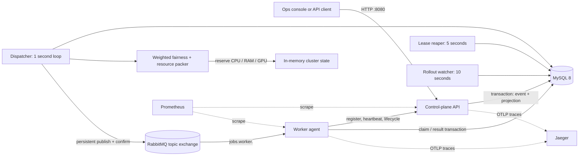
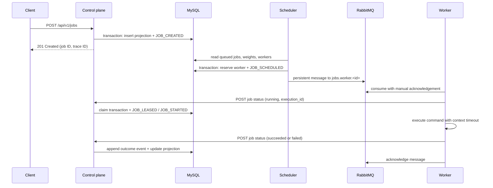

# AtlasFarm Architecture

AtlasFarm is a resource-aware job execution platform. The Go control plane
accepts and persists work, a periodic dispatcher selects a tenant and worker,
RabbitMQ delivers the assignment, and a Go worker agent runs the command and
reports its outcome.

## High-level design



The local Compose stack provides MySQL, RabbitMQ, Prometheus, Grafana, Loki, and
Jaeger. In the host-based development workflow, only these infrastructure
services are containers; the control plane and workers are Go processes on the
host. The optional Kind setup runs the services in a local Kubernetes cluster.

## Job write path and CQRS projection

`POST /api/v1/jobs` validates the request and checks the tenant's resource and
active-job quotas. A transaction writes the `jobs_projection` row and appends
`JOB_CREATED` to `job_events`. The projection is the read-optimized current
state; the ordered event table is the audit history. State transitions similarly
append an event and update the projection in a single transaction, using the
per-job sequence number and unique `(job_id, sequence_num)` constraint.

The implementation provides the event log and transactional projection pattern;
it does not currently include an operator-facing projection rebuild/replay
command. RabbitMQ publishing occurs asynchronously from the dispatcher after
the database transaction, so the SQL commit and broker publish are not one
distributed transaction. Persistent messages, publisher confirms, worker
claims, lease recovery, and fencing limit the impact of duplicate or interrupted
delivery, but do not remove that cross-system atomicity gap.



Idempotency keys are unique in MySQL. A repeated submission returns the
existing projection instead of creating another job or event. The dispatcher
polls queued jobs and worker state; MySQL remains authoritative for durable job
state while an in-memory cluster snapshot is used for fast capacity selection.

## Scheduling and execution

The scheduler applies weighted fair selection across tenant queues, then filters
workers by liveness, available CPU, memory, and GPU. The configured
`SCHEDULER_STRATEGY` chooses first-fit, best-fit, or worst-fit packing. A canary
rollout deterministically partitions eligible jobs by job ID and runner version.
The detailed scoring and limitations are in [scheduler.md](scheduler.md).

Worker agents register their advertised capacity, heartbeat every five seconds,
consume a worker-specific durable RabbitMQ queue with bounded prefetch, claim
each job before execution, and report the terminal result. Their advertised
resources guide scheduling; they are not OS-level CPU or memory limits. GPU
capacity is metadata for placement and does not provide GPU device isolation.
Commands run directly on the worker host through the platform shell; workers
are not a security sandbox for untrusted commands.

## Persistence and infrastructure roles

| Component | Responsibility |
| --- | --- |
| MySQL 8 | Tenant weights/quotas, current job projections, append-only lifecycle events, worker heartbeat/capacity state, and rollout configuration. |
| RabbitMQ 3 | Durable topic exchange `atlasfarm.jobs`; the dispatcher routes to `jobs.worker.<worker-id>`. |
| Prometheus | Scrapes control-plane and worker metrics. Kind uses pod discovery with namespace-scoped read-only RBAC. |
| Grafana | Local visualization endpoint; Compose does not provision dashboards or data sources. |
| Loki | Local log storage; the current stack does not include an application log shipper. |
| Jaeger | Receives OTLP gRPC traces on port 4317 and provides the trace UI. |

`deploy/init.sql` initializes the schema and seeds tenants A, B, and C with
weights 40, 30, and 30. Control-plane startup also performs the small schema
migrations required by the current binary.

## Distributed tracing

The control plane starts a root span for job submission and persists the trace
ID and W3C `traceparent`. The dispatcher extracts the stored context, creates a
scheduler span, and injects W3C trace headers into RabbitMQ. A worker extracts
those headers, creates its execution span, and propagates context through
lifecycle callbacks. Both Go services export OTLP gRPC to
`OTEL_EXPORTER_OTLP_ENDPOINT` (default `localhost:4317`). A trace may not appear
if Jaeger is unreachable or export errors are reported in the service logs.

## Reliability and trade-offs

* **Database and broker are separate systems.** A process can persist a
  schedule transition and lose its broker connection before publishing. The
  publisher retries with backoff; the lease reaper recovers assignments that do
  not complete. A transactional outbox would strengthen this boundary but is
  not implemented.
* **At-least-once delivery is expected.** RabbitMQ messages are persistent and
  manually acknowledged. The control-plane claim and `execution_id` fencing
  prevent duplicate/stale deliveries from committing a second outcome.
* **The dispatcher and resource snapshot are simple, not horizontally
  coordinated.** Multiple control-plane replicas can read and schedule the
  same queued set; SQL row locks and worker reservations protect important
  writes, but the in-memory resource view is local to each process. The
  development design is not a substitute for distributed scheduler leadership
  or a shared reservation service.
* **Local Kubernetes is a demonstration baseline.** The manifests use
  single-replica infrastructure, local credentials, and a simulated GPU worker
  pool. Production use requires managed/persistent infrastructure, external
  secret management, network policy, backups, and tested failure domains.

## Repository map

```text
control-plane/  REST API, event store, dispatcher, reaper, rollout watcher
worker-agent/   registration, heartbeats, RabbitMQ consumer, command execution
scheduler/      weighted fairness, resource packing, in-memory cluster state
deploy/         Compose stack, SQL schema, Kind Kubernetes manifests
scripts/        local chaos, benchmark, and Kind deployment helpers
k6/             10,000-job HTTP load test
web-console/    React + TypeScript operations UI
docs/           architecture, scheduler, reliability, benchmark guides
```
